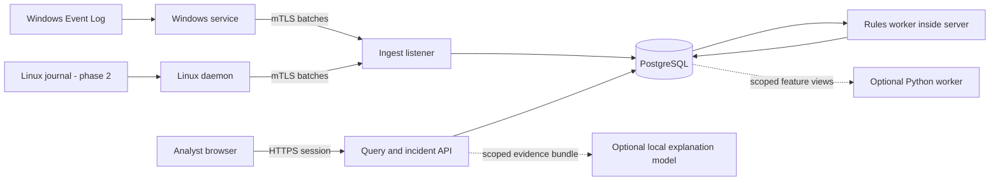
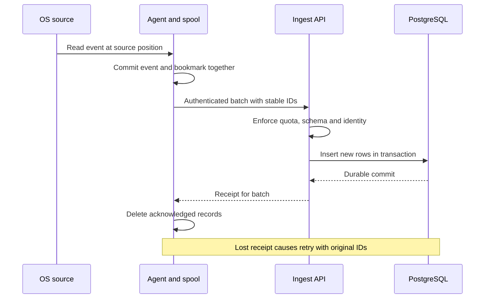
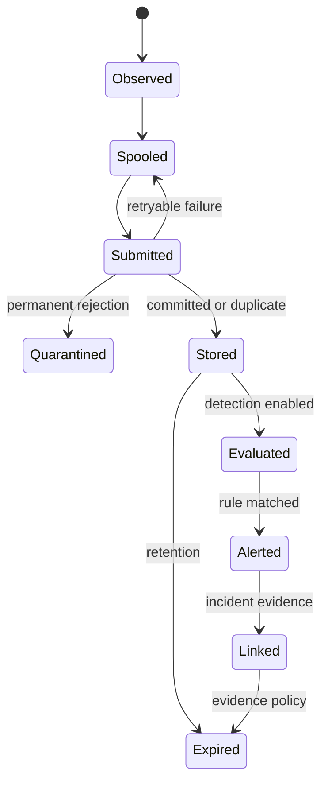

# Architecture

Deploy one native agent per machine and one modular Rust server backed by PostgreSQL. The server serves the analyst UI, handles enrollment and commits batches. A separate listener requires agent certificates. Agent and browser routes have distinct authentication policies. Keep query and ingest connection pools bounded independently so an expensive investigation cannot consume every writer connection.

## Endpoint collection

Use a pull subscription on a dedicated blocking thread, filter by provider/channel/code and render structured XML. Parse by field name and source version. Keep channel bookmarks and normalized records in the same local SQLite transaction. Generate an event UUID on first spooling. Per-source serialization prevents simultaneous readers from advancing one bookmark. On initial enrollment start at the current tail and record that coverage boundary. On stale bookmark start a new source generation at the oldest available record, report a gap and label possible source overlap. Native record numbers can restart after a clear. [Microsoft subscriptions](https://learn.microsoft.com/en-us/windows/win32/wes/subscribing-to-events) · [Bookmarks](https://learn.microsoft.com/en-us/windows/win32/wes/bookmarking-events)

The Linux daemon will reuse spool, transport and health logic. Prefer journal cursors for the first SSH adapter. File tailing adds rotation and inode reuse cases. Add it for distributions without a suitable journal after testing those cases. Process snapshots and socket polling can miss short-lived activity. Compare audit records and optional Aya probes against a known event manifest before promising process or connection completeness. [systemd journal API](https://www.freedesktop.org/software/systemd/man/latest/sd-journal.html) · [Aya](https://aya-rs.dev/book/)

## Ingestion and recovery

Cap the spool at a proposed 256 MiB per agent. On saturation pause the reader before advancing the bookmark and expose pressure through an independent heartbeat. Reserve space for metadata. Retry with exponential backoff and jitter capped at 60 s. Source rotation during a pause may destroy unread evidence. A permanent rejection goes to a bounded local diagnostic queue with the reason and a count. Drain valid records independently. Prioritize live health even while catching up.

## Detection and investigation

In Phase 3, insert pending evaluation work in the event transaction. A bounded worker claims work with leases. Write results, evidence links and completion atomically. Uniqueness on rule version, endpoint and triggering event makes replay safe. Re-evaluate affected groups when events arrive out of order. Allow two minutes of event-time lateness, route older records to a labelled historical evaluation. For skew over five minutes flag the clock and use receipt time in a separate degraded-confidence window. Record the window clock and rule version on the alert.

| Initial rule candidate | Key and condition | Evidence and tuning |
| --- | --- | --- |
| Failed logon burst then success | At least five failures in five minutes followed by success within ten minutes on the same endpoint, target and source IP | Retain all matching IDs. Exclude missing IP from this chain. Tune service-account cohorts separately. |
| Sensitive execution then connection | New process outside an approved role profile connects to a first-seen destination within two minutes | Join on endpoint, boot and process start identity. PID alone is insufficient. Record profile version. |
| Elevation then sensitive file change | Within five minutes on one endpoint and authenticated session | Require elevation evidence and a configured protected path. Maintenance exclusions expire and are audited. |

Standalone rules cover authentication bursts, unusual privilege use, role-specific sensitive commands, unexpected parent/child pairs, restricted destination ranges and protected-file writes. Enable each only when its source fields are available. Aggregate related alerts in one open incident by endpoint, principal and rule family within a rolling 30-minute gap. Lock the group during aggregation. A closed incident remains closed and subsequent activity links to it.

Proposed risk score = base rule impact (10/30/50/70) + independent corroboration (0/15) + asset criticality (0/15), capped at 100. Low 0–29, medium 30–59, high 60–84, critical 85–100. Emit components, evidence and rule version. Anomaly-only findings start at 10. Asset criticality comes from administrators. Incidents inherit maximum active alert risk. Analysts record disposition separately and explain overrides.

## Analyst interface and optional inference

Refresh MVP overview and explorer with cursor-based polling every five seconds. Show freshness, collector gaps and empty states. Preserve filters and a stable scroll position while new events arrive. Phase 3 links every timeline item to evidence or an explicit expiry marker. Add server-sent events only if measured polling load or freshness demands it.

An optional local assistant receives a server-selected, access-checked evidence bundle. It can describe rule logic, summarize evidence, suggest read-only investigation steps and draft reports. Separate observations from hypotheses. Validate every factual citation against authorized IDs and supplied fields, reject unsupported claims and abstain on missing evidence. It has no action tools, credentials or incident-write permission. Analyst review precedes report publication.
