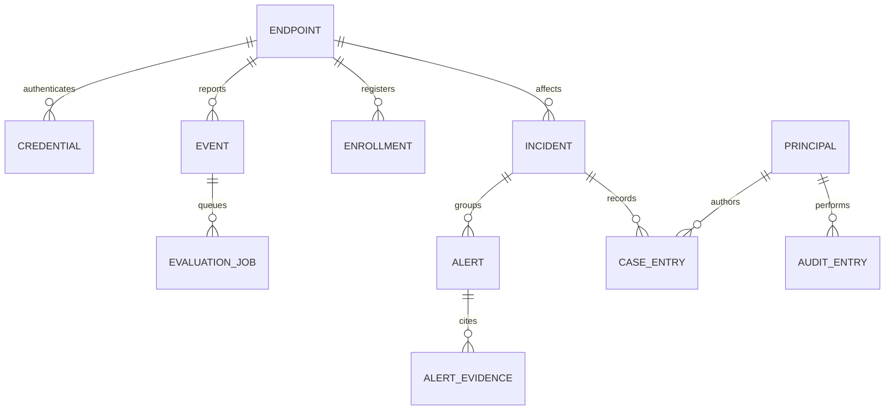

# Data model

Use an ECS-aligned subset with a versioned Sentinel envelope. ECS supplies field meanings for authentication, host, user and network data and maps naturally onto both Windows logons and SSH. OCSF's class and activity model is attractive for future interchange but adds class mapping work before the first explorer works. Publish an explicit field mapping before claiming compatibility with either complete schema. [ECS](https://www.elastic.co/docs/reference/ecs) · [OCSF](https://schema.ocsf.io/)

## Canonical example

Synthetic agent payload, using nested JSON. Agent identity and receipt metadata are added by the server.

```json
{
  "schema_version": 1,
  "@timestamp": "2026-01-10T15:04:05.123Z",
  "event": {
    "id": "41e446fb-1f33-46f0-b972-716905054bd9",
    "kind": "event",
    "category": ["authentication"],
    "code": "4625",
    "outcome": "failure"
  },
  "host": {"name": "lab-win-01", "os": {"type": "windows"}},
  "user": {"name": "sample-user"},
  "source": {"ip": "192.0.2.14"},
  "sentinel": {
    "source": "windows.security",
    "provider": "Microsoft-Windows-Security-Auditing",
    "record_id": "1729",
    "source_generation": "lab-1",
    "parser_version": "1.0.0"
  }
}
```

Require schema version, UTC RFC 3339 event time, UUID, category, kind, outcome (success/failure/unknown), code, OS type, source and parser version. For Windows require provider, generation and channel-local record ID. Host name and account are endpoint claims. Map TargetUserName/TargetUserSid to user.name/user.id, IpAddress to source.ip and LogonType to a typed source extension. Missing or placeholder values stay absent. Linux preserves journal cursor and boot ID under the source namespace. Preserve timestamps separately for occurrence, agent observation when available and server receipt. Enrichment adds authoritative endpoint UUID and inventory tags. Never accept client-supplied risk or role as authoritative.

## Logical entities



| Relation | Keys, constraints and access paths |
| --- | --- |
| endpoint, enrollment, credential | Endpoint UUID PK, source platform, last heartbeat, collector state, disabled time. Unique token digest and cert serial. Token has expiry and consumed time. Enrollment and credential reference endpoint. |
| event | Composite PK (endpoint_id, event_id), immutable normalized payload, canonical payload digest, UTC occurrence and receipt. Index (endpoint_id, received_at, event_id) and (received_at, endpoint_id, event_id). Store commonly filtered code and outcome as typed columns. |
| evaluation_job, alert | Phase 3. Unique job per event/rule version, lease expiry and retries. Unique alert fingerprint. Alert has endpoint, rule/version, score components, incident FK and creation time. |
| alert_evidence, incident, case_entry | Unique alert plus composite evidence ID. Store minimum reason and source time with a logical reference surviving raw expiry. Incident has owner, severity, status and revision. Entries append notes, evidence, status and prior/new values with actor and time. |
| principal, audit_entry | Principal keyed by issuer and subject. Audit actor may also be a system identity. Audit writes are append-only for application roles. |

Use bounded deletes on an unpartitioned pilot table to keep global event uniqueness simple. Benchmark vacuum, indexes and query plans under retention. Before time partitioning, design a separate dedup ledger or a partition-aware identity scheme. Reject incoming new records older than the replay horizon defined in the API. Repeated submissions with changed payloads are conflicts. [PostgreSQL partitioning constraints](https://www.postgresql.org/docs/current/ddl-partitioning.html)
