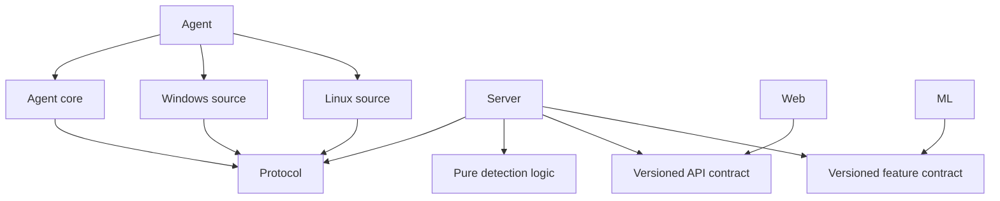

# Repository and engineering standards

Phase 0 contains the design under docs, a contributor guide, documentation checks and the license. Introduce each runtime directory with its first working feature.

```text
apps/
  agent/                 native service entry points and OS packaging hooks
  server/                ingest, enrollment, query and worker composition
  web/                   typed analyst UI
crates/
  protocol/              wire types and validation
  agent-core/            durable spool, transport and source health
  windows-source/        Event Log handles, XML mapping and bookmarks
  linux-source/          journal mapping and cursors (Phase 2)
  detection/             pure rules, correlation and scoring (Phase 3)
workers/ml/              Python experiments and optional scorer
contracts/               versioned JSON Schema, OpenAPI and examples
migrations/              ordered PostgreSQL migrations
infra/                   Compose, optional monitoring profiles and packaging
tests/                   synthetic fixtures, platform, integration and E2E suites
bench/                   seeded load generator and result manifests
docs/                    architecture, roadmap and operating guides
.github/workflows/       CI and release jobs
```



Arrows describe build or contract dependencies. Platform-specific code owns native resources. Core accepts normalized records and opaque checkpoints. Avoid traits for every struct. Introduce interfaces at replaceable sources, clocks, persistence and external inference. The UI calls the API over HTTPS. Only the server and explicitly scoped workers access database roles. Rules receive typed data and return matches without performing I/O.

## Engineering conventions

- Rust uses owned records across task boundaries and borrowed source data within a parsing call. Wrap native handles in RAII types, confine unsafe code to reviewed FFI with documented safety invariants. Use typed recoverable errors with context at process boundaries. Never panic on telemetry. Bound channels and task counts, propagate cancellation, drain or persist pending work at shutdown and keep blocking calls off async threads.
- Version configuration, validate at startup, document precedence (defaults, file, explicit environment overrides), redact secrets and reject incompatible settings. Log structured request, endpoint and rule IDs, component, duration and error class. High-cardinality identifiers belong in logs, outside metric labels.
- Keep API v1 changes additive with documented defaults. Negotiate incompatible changes with a new major version. Check old agent fixtures against new servers. Use ordered SQLx migrations, expand/backfill/contract across compatible releases and test forward upgrade and backup restoration.
- Format Rust with rustfmt, lint with Clippy, pin a supported toolchain and audit dependencies. Type-check frontend in strict mode and lint/test filters and accessibility. Python uses typed boundaries, a locked environment, Ruff, a type checker and pytest. Track feature schema, model digest, training dataset manifest and seed together.
- GitHub Actions grows with code. Use Windows and Linux build/unit jobs, Linux PostgreSQL integration, a separately authorized Windows VM suite, contract compatibility and tagged release signing. Pin external actions to reviewed commits and grant read-only permissions by default. Use SemVer for releases, changelog and migration notes. Require passing checks and review of schema/security changes.
